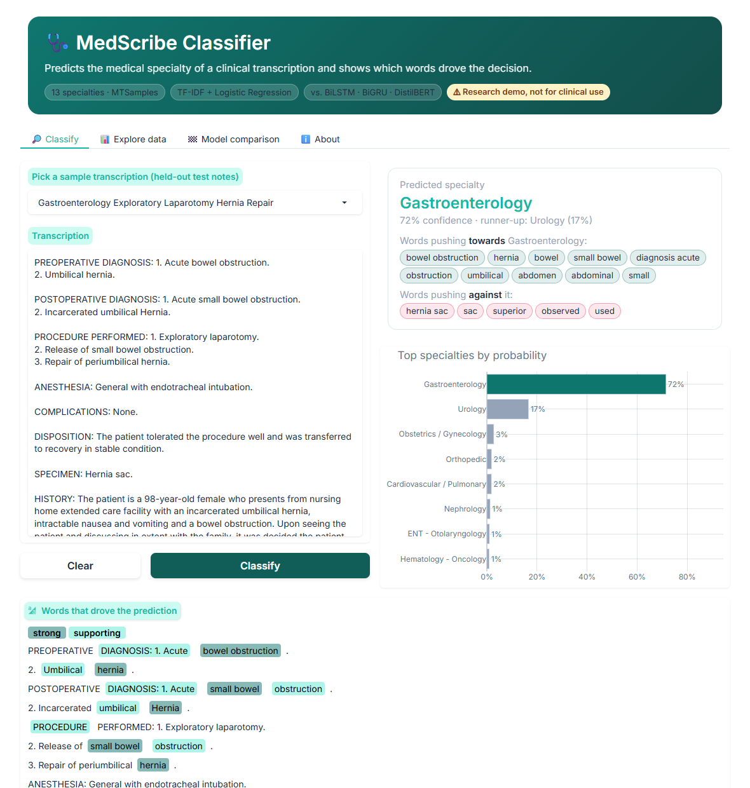
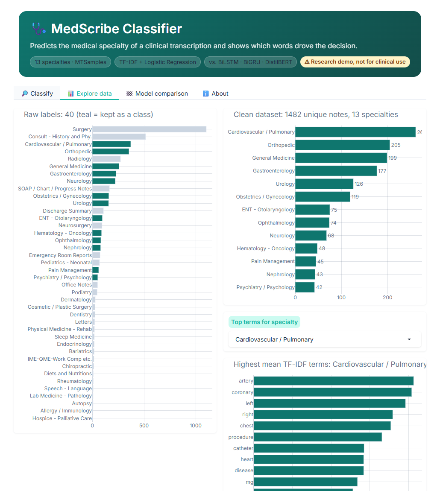
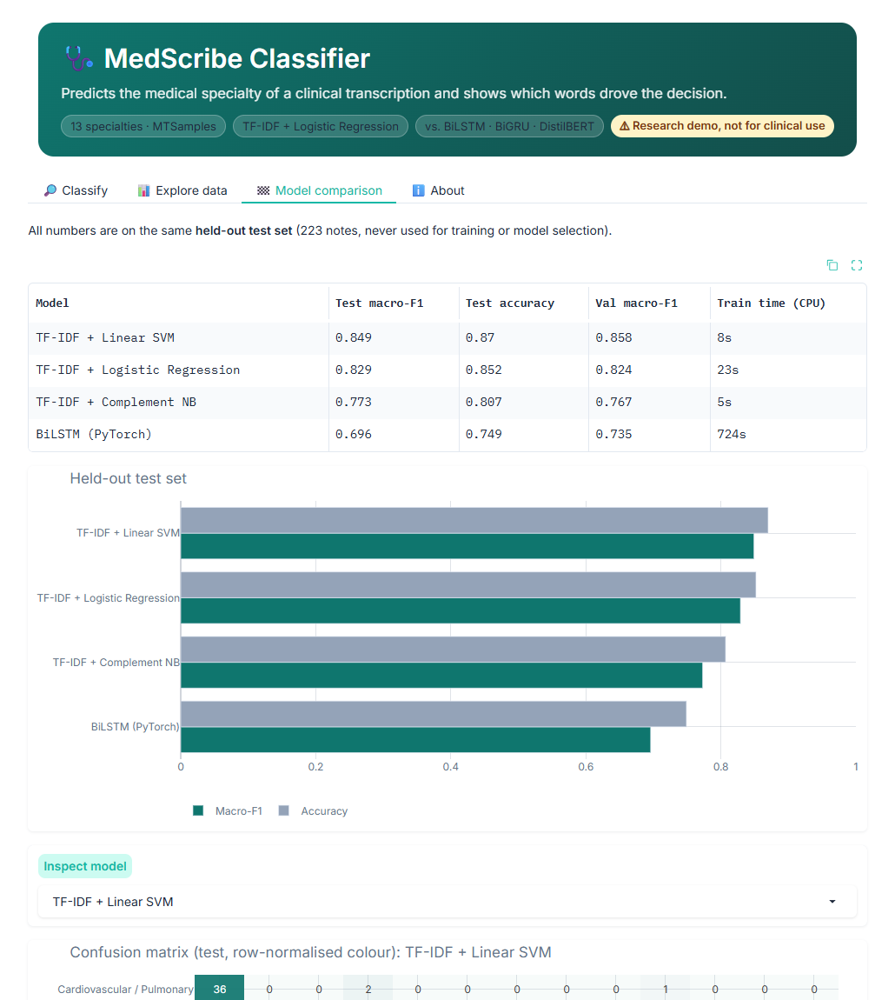
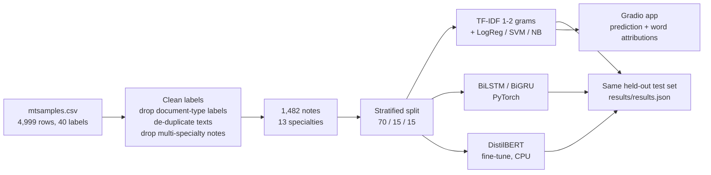

# 🩺 MedScribe Classifier: medical transcription → specialty

**Paste a clinical note and get its medical specialty, a confidence chart, and the exact words that drove the decision.**
NLP on 1,482 de-duplicated MTSamples transcriptions across 13 specialties, with honest held-out evaluation of linear, recurrent and transformer models.



> ⚠️ Research demo, not for clinical use.

## Features

- **Specialty prediction** for any pasted transcription (13 classes), with a probability bar chart and a low-confidence warning.
- **Explanations you can verify.** Words are highlighted in the note by their exact contribution to the predicted class (*tf-idf × coefficient*), plus the words that pushed *against* it.
- **5 one-click samples** taken from the held-out test set (`examples/`); one of them is a real misclassification, shown on purpose.
- **Explore data tab:** raw vs. cleaned label distribution, top TF-IDF terms per specialty, and an interactive t-SNE map of all notes.
- **Model comparison tab:** test macro-F1 / accuracy for every model, confusion matrices and per-class F1.
- Runs fully **offline on CPU**. No API keys are needed, and the app starts in a few seconds.

| Explore data | Model comparison |
|---|---|
|  |  |

## How it works



**The data trap.** MTSamples has 4,999 rows but only **2,357 unique transcriptions**. Most notes are filed twice: once under a specialty (*Orthopedic*) and once under a *document type* (*Surgery*, *Consult - History and Phy.*, *SOAP / Chart / Progress Notes*, …). A random split therefore puts copies of the same note in both train and test, and gives the same text two contradictory labels. This project:

1. drops the 8 document-type labels,
2. keeps **one row per unique note**,
3. drops notes still tagged with two specialties (e.g. Neurology + Radiology),
4. keeps specialties with ≥ 40 notes → **1,482 notes, 13 classes**,
5. splits them 70/15/15 with stratification (1,037 / 222 / 223). Hyper-parameters are chosen on validation, and the test set is scored once.

**Why the linear model powers the app.** It is the most accurate model here, trains in seconds, and is exactly explainable: the logit of class *k* is Σ tfidf(word) × W[k, word] + b, so each highlighted word's weight is its real contribution.

## Results

All models are scored on the **same held-out test set (223 notes)**. Macro-F1 weighs every specialty equally, which matters because the classes range from 42 to 261 notes.

| Model | Test macro-F1 | Test accuracy | Val macro-F1 | Train time (CPU) |
|---|---:|---:|---:|---:|
| TF-IDF + Linear SVM | 0.849 | 0.870 | 0.858 | 8 s |
| TF-IDF + Logistic Regression | 0.829 | 0.852 | 0.824 | 23 s |
| TF-IDF + Complement NB | 0.773 | 0.807 | 0.767 | 5 s |
| BiLSTM (PyTorch) | 0.696 | 0.749 | 0.735 | 724 s |

> **Status (WIP):** the BiGRU run was killed by an out-of-memory error at epoch 10 (val macro-F1 0.698 at that point) on a shared 8 GB machine, and the DistilBERT fine-tune has not been run yet. Re-run `python -m src.train_rnn` and `python -m src.train_transformer --batch 8` to add them. Screenshots in `docs/` are still to be captured.

*Train times are wall-clock on a shared 8-core CPU laptop with other jobs running, so read them as rough.*

Observations:
- **TF-IDF + linear models win** on this small dataset (~1k training notes). Specialty is mostly signalled by vocabulary (*cataract*, *stent*, *colonoscopy*), which bag-of-n-grams captures well.
- The **recurrent models** need far more data to learn their embeddings from scratch.
- **DistilBERT** sees only the first 256 word-pieces of notes whose median length is ~400 words, and was fine-tuned for only a few epochs on CPU.
- Most errors flow **into *General Medicine***. Gastroenterology, Nephrology, Psychiatry and Hematology notes written as general history-and-physicals look like GP notes, and *General Medicine* itself is the hardest class (F1 ≈ 0.70). The weakest specialties are **Nephrology (F1 0.50, 6 test notes)** and **Pain Management (0.67)**. Ophthalmology, ENT, Orthopedic and Urology score ≥ 0.92.

### What the original notebook reported, and what was fixed
The bootcamp notebook (kept in [`notebooks/healthcare_original.ipynb`](notebooks/healthcare_original.ipynb)) trained its LSTM and GRU with a single sigmoid output and binary cross-entropy on a **40-class** integer label. The loss diverged to about −3000 and accuracy stayed at **0.15%**. It also trained on the short `description` field instead of the transcription, and used a split that leaked duplicates. `src/train_rnn.py` fixes all three: a softmax head, (class-weighted) cross-entropy, the transcription text, and the leak-free split.

## Quick start

Requires Python 3.10+ (tested on 3.12, Windows, CPU only).

```bash
python -m venv .venv
.venv/Scripts/activate            # macOS/Linux: source .venv/bin/activate
pip install -r requirements.txt
python app.py                     # open http://127.0.0.1:7860
```

The trained model (`models/tfidf_logreg.joblib`), the metrics (`results/`) and the dataset (`data/mtsamples.csv`) are committed, so the app runs straight after cloning.

**Reproduce everything:**

```bash
python -m src.train_linear        # TF-IDF + LogReg / SVM / NB, writes the app's model (~1-5 min)
python -m src.eda                 # EDA stats + t-SNE + sample notes
pip install -r requirements-dl.txt
python -m src.train_rnn           # BiLSTM + BiGRU
python -m src.train_transformer   # DistilBERT fine-tune (slow on CPU; weights not saved to git)
python -m src.report              # prints the results table above
```

## Project structure

```
app.py                  Gradio Blocks UI (Classify / Explore data / Model comparison / About)
src/data.py             loading, label cleaning, de-duplication, stratified split
src/train_linear.py     TF-IDF + Logistic Regression / Linear SVM / Complement NB
src/train_rnn.py        BiLSTM / BiGRU (PyTorch)
src/train_transformer.py DistilBERT (or Bio_ClinicalBERT) fine-tune
src/predict.py          inference + per-word attributions + highlighting
src/eda.py, report.py   EDA artifacts, results table
data/mtsamples.csv      dataset (17 MB)
models/                 trained linear model + RNN weights
results/                results.json (all metrics), eda.json, training logs
notebooks/              original bootcamp notebook (cleaned, with audit notes)
examples/               5 held-out sample notes for the app
```

## Tech stack
Python 3.12 · scikit-learn · PyTorch · Hugging Face Transformers · Gradio 6 · Plotly · pandas

## Dataset and credits
- **MTSamples** medical transcription samples, via the Kaggle dataset [tboyle10/medicaltranscriptions](https://www.kaggle.com/datasets/tboyle10/medicaltranscriptions), scraped from [mtsamples.com](https://mtsamples.com). The notes are de-identified sample reports. The 17 MB CSV is committed in `data/` because it was already part of the original repository's history and is well under GitHub's file limits. If you prefer to download it yourself, get `mtsamples.csv` from the Kaggle page (login required) and place it in `data/`.
- `distilbert-base-uncased` from Hugging Face.

## Author
**Amna Choudhri**

Originally developed as a team university project; this version was refactored and extended by Amna Choudhri.

What this rebuild added:
- An audit of the original notebook and fixes for the broken LSTM/GRU setup (wrong output layer and loss, wrong input field).
- A leak-free data pipeline (duplicate and document-type label handling) with a stratified train/val/test split.
- TF-IDF linear baselines, corrected BiLSTM/BiGRU, a DistilBERT fine-tune, and one honest results table.
- Word-level explanations of each prediction.
- A themed Gradio app with Classify, Explore data and Model comparison tabs.
- A reproducible `src/` package, pinned requirements, and this documentation.

## License
MIT; see [LICENSE](LICENSE).
